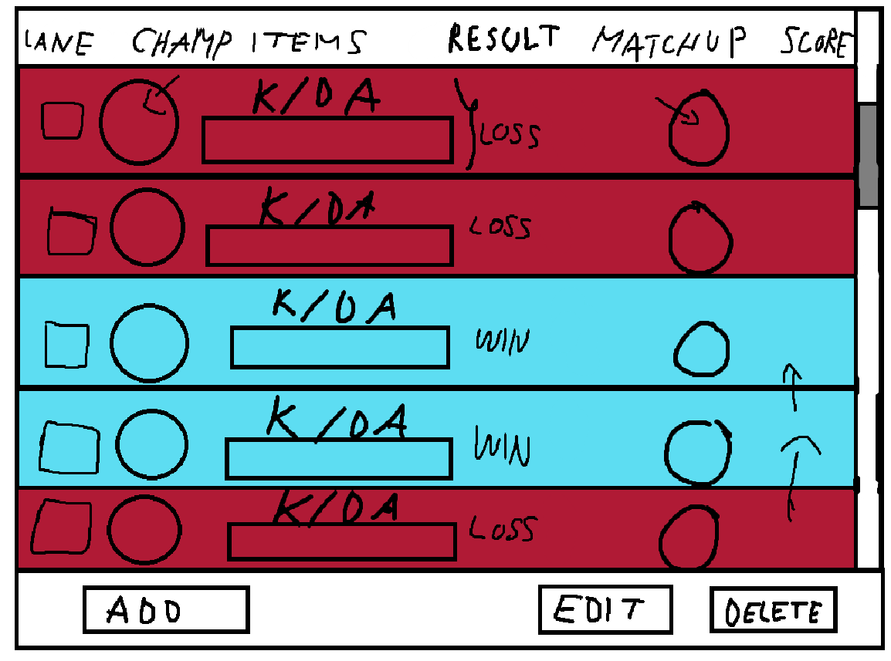
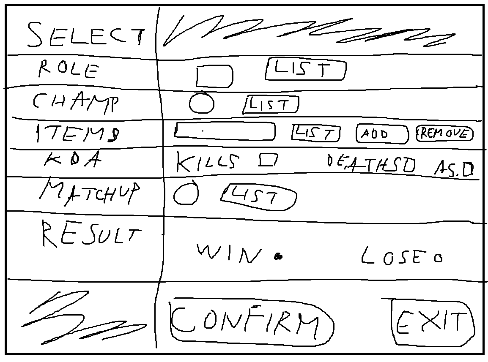
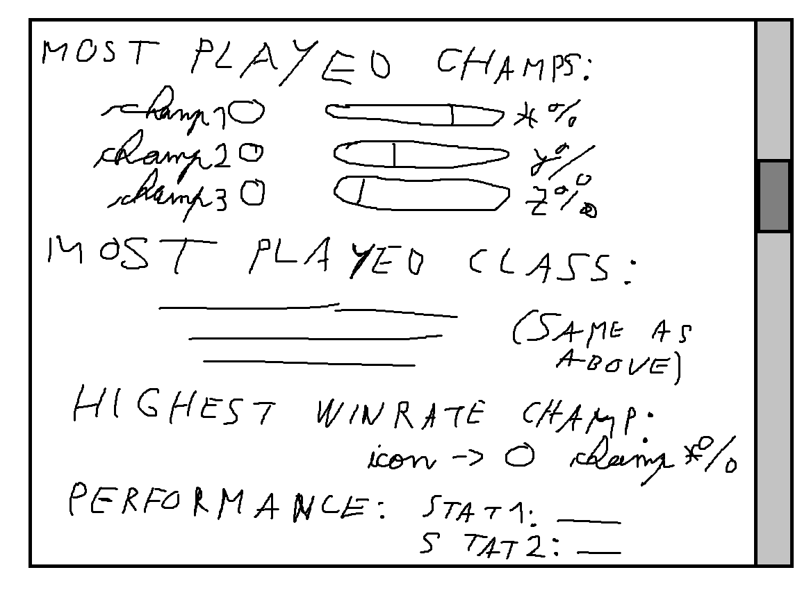

# User Interface Plan

## View 1

**Key functionality**

- GameCollection (The list of games that the user can see)
- Opens on startup
- The user can add games by clicking the "add" button, edit them by clicking the
"edit" button and delete them by clicking the "delete" button

**Key components**

- GameCollection for the list of games
- TableView for the games, bound to the GameCollection
- Buttons

## View 2

**Key functionality**

- Editable game attributes
- Opened when double-clicking a game or selecting
a game and clicking the 'edit' button
- The user can select, change or remove information
about the game (champion, matchup, items, kda, result, role)

**Key components**

- Buttons (add, remove, confirm, exit)
- RadioButton paired with a ToggleGroup for win/lose
- Scroll down list (possibly paired with a TextField for filtering the list) (list oh champions, items)
- TextFiled for numbers (kda)

## View 3

**Key functionality**

- Game stats
- Opened either by a button from the GameListView,
or by clicking on a 'tab' (there would be 2 tabs, 'Games' and 'Stats')
- The user can view his stats, but not modify them

**Key components**

- VBox inside a ScrollPane to make the stats scrollable (otherwise wouldn't fit)
- TableView for the lists of "most x y" (max 3)
- Text fields for the stat titles